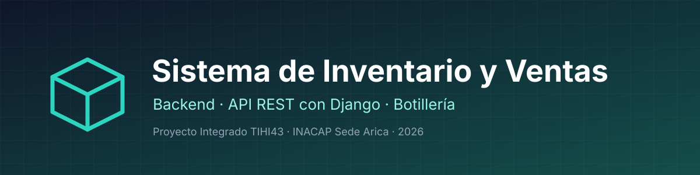
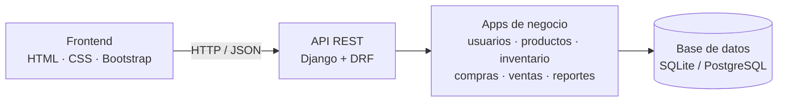
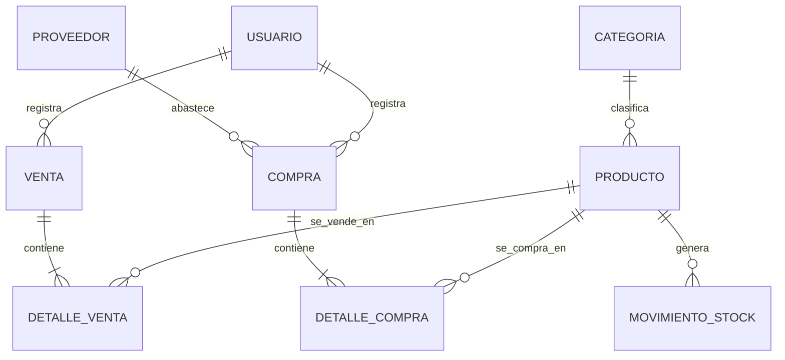
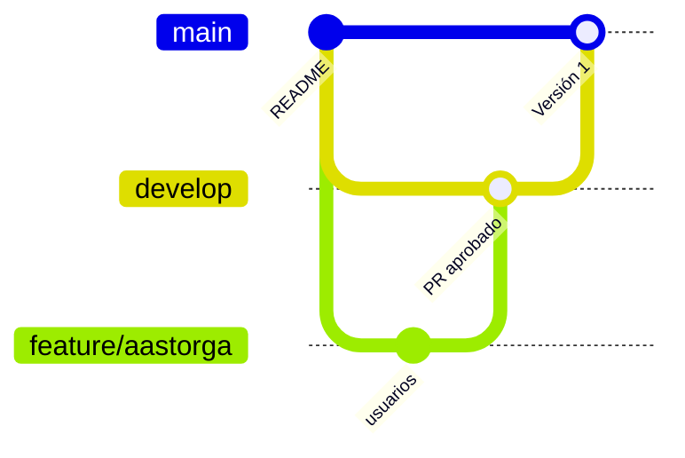

<p align="center">
  
</p>

<p align="center">
  
  
  
  
  
  
</p>

<p align="center">
  API y lógica de negocio de un sistema de inventario y ventas para una botillería pequeña, pensado para consultarse también desde el celular.
</p>

---

## Contenido

[Sobre el proyecto](#sobre-el-proyecto) · [Arquitectura](#arquitectura) · [Modelo de datos](#modelo-de-datos) · [Tecnologías](#tecnologías) · [Estructura](#estructura-del-proyecto) · [Instalación](#instalación) · [Seguridad](#seguridad) · [Flujo de trabajo](#flujo-de-trabajo-en-git) · [Hoja de ruta](#hoja-de-ruta) · [Equipo](#equipo)

---

## Sobre el proyecto

El sistema reemplaza el control manual del inventario de una botillería. Este repositorio contiene el **backend**; la interfaz (HTML, CSS y Bootstrap) está en el repositorio [`SistemaBotelleria`](https://github.com/Angel-Asto/SistemaBotelleria).

| Funcionalidad | Descripción |
|---|---|
| **Productos** | Registro, edición, baja y búsqueda por código de barras, nombre o categoría |
| **Ventas** | Escaneo del producto, total automático, confirmación de edad en alcohol, anulación y comprobante |
| **Inventario** | Descuento automático de stock por venta, entradas, historial y alerta de stock bajo |
| **Compras** | Proveedores, registro de compras y suma al stock |
| **Reportes** | Ventas por período y productos más y menos vendidos |
| **Usuarios** | Cuentas Admin y Trabajador, con inicio de sesión y cambio de contraseña |

## Arquitectura



## Modelo de datos

> [!NOTE]
> Vista provisional de las entidades y sus relaciones. Los atributos se completan al migrar el diagrama entidad-relación del informe.



## Tecnologías

| Componente | Tecnología |
|---|---|
| Lenguaje | Python 3 |
| Framework | Django 5.x (patrón MTV, equivalente a MVC) |
| API | Django REST Framework |
| Base de datos en desarrollo | SQLite |
| Base de datos en producción | PostgreSQL o MySQL |
| Variables de entorno | python-dotenv |
| Control de versiones | Git y GitHub |

## Estructura del proyecto

Una app de Django por gestor, igual que en el prototipo.

```text
backend-inventario-botilleria/
├── config/            # Configuración del proyecto (settings, urls)
├── usuarios/          # Usuario con rol, inicio de sesión, contraseña
├── productos/         # Producto y Categoría
├── inventario/        # Movimientos de stock y alertas
├── compras/           # Proveedor, Compra y DetalleCompra
├── ventas/            # Venta, DetalleVenta, anulación y comprobante
├── reportes/          # Reportes de ventas y de productos
├── assets/            # Imágenes del README
├── requirements.txt
├── .env.example
└── manage.py
```

## Instalación

<details>
<summary><b>Ver los pasos para ejecutarlo en desarrollo</b></summary>

<br>

```bash
git clone https://github.com/Angel-Asto/backend-inventario-botilleria.git
cd backend-inventario-botilleria
python -m venv venv
venv\Scripts\activate          # Windows
pip install -r requirements.txt
copy .env.example .env         # completar los valores
python manage.py migrate
python manage.py runserver
```

El servidor queda disponible en `http://127.0.0.1:8000/`.

</details>

## Seguridad

| Medida | Cómo se aplica |
|---|---|
| Contraseñas | Almacenadas con hash (el de Django por defecto) |
| Roles | Admin y Trabajador, validados **en el servidor** en cada vista |
| Consultas | A través del ORM de Django (parametrizadas), sin SQL armado a mano |
| Claves y configuración | En el archivo `.env`, que no se sube al repositorio |
| Entradas del usuario | Validadas en los serializadores, con protección CSRF activa |

## Flujo de trabajo en Git



- `main`: versión estable, solo recibe cambios desde `develop` mediante Pull Request.
- `develop`: rama de integración y pruebas.
- `feature/<inicial><apellido>`: rama personal de cada integrante, creada desde `develop`.

> [!IMPORTANT]
> No hay commits directos en `main` ni en `develop`. Cada commit es un solo cambio, con mensaje en español y en presente.

## Hoja de ruta

- [x] Repositorio, README y ramas
- [ ] Esqueleto del proyecto Django y configuración segura
- [ ] Modelos y migraciones
- [ ] Autenticación y roles
- [ ] API de productos, inventario, compras y ventas
- [ ] Reportes
- [ ] Pruebas unitarias, de integración y de rendimiento
- [ ] Despliegue

## Equipo

| Integrante | GitHub | Rama | Apps a cargo |
|---|---|---|---|
| **Angel Astorga** | [@Angel-Asto](https://github.com/Angel-Asto) | `feature/aastorga` | `usuarios`, `inventario`, `compras`, `reportes` |
| **Kinerett Castillo** | [@ukinekay](https://github.com//kinekay) | `feature/kcastillo` | `productos`, `ventas` |

<p align="center">
  <sub>Proyecto Integrado – TIHI43 · INACAP Sede Arica · Docente: Valery Rodríguez</sub>
</p>
